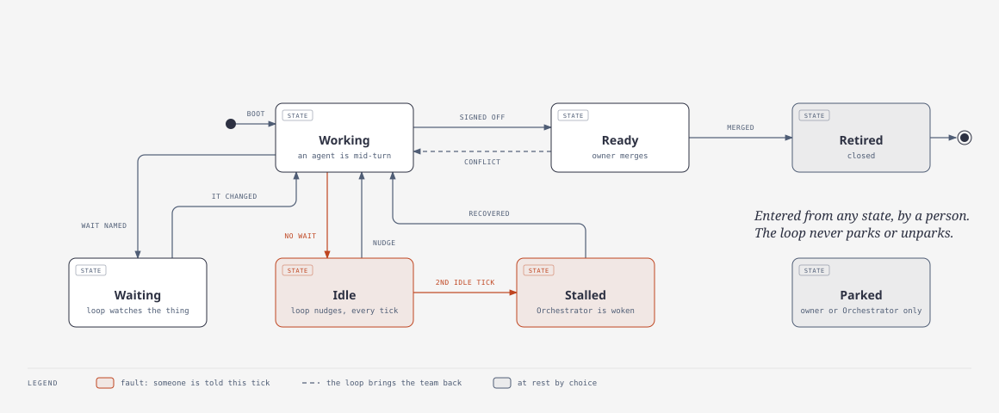
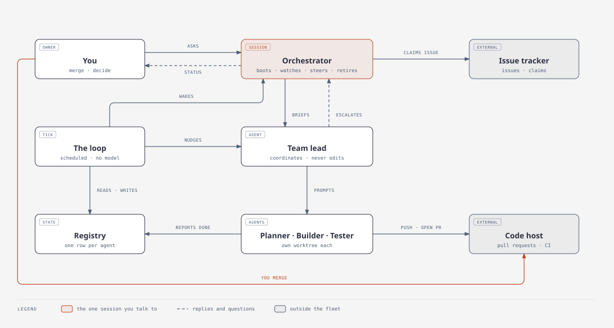
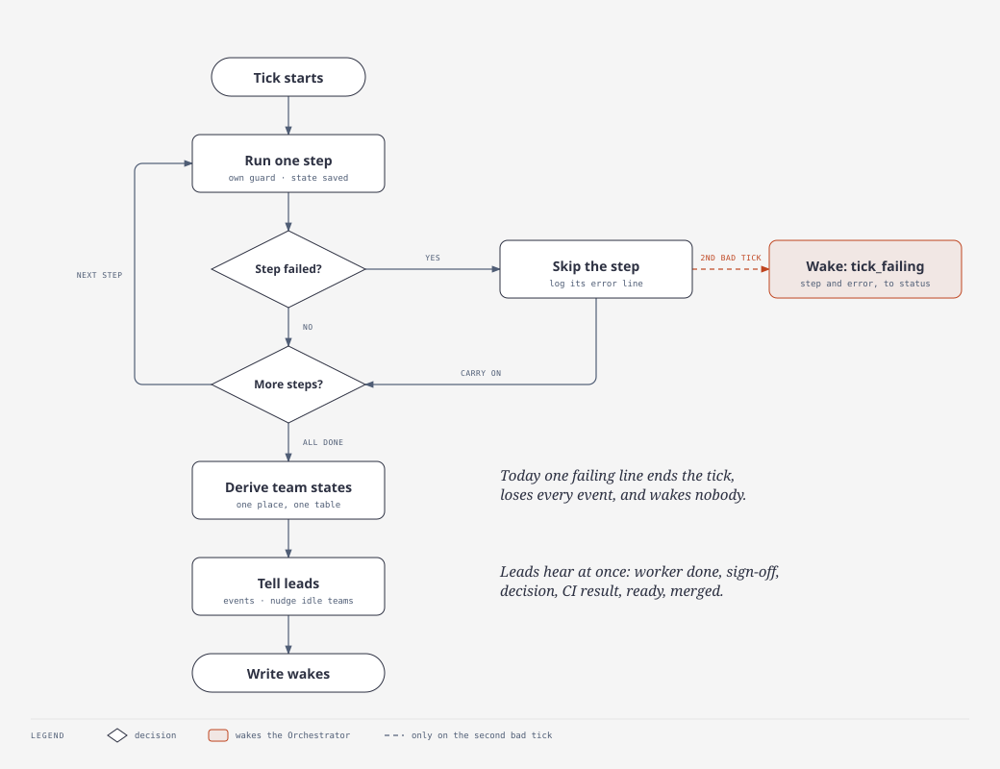

# Fleet

Run teams of coding agents from one chat. You say what you want built, or point it at your issues. The Orchestrator
boots a team in [herdr](https://herdr.dev): a lead, a planner, a builder and a tester, each writer on its own git
worktree. The team ends in a pull request a tester has checked at an exact commit. You merge it.

**For you if** you run several agents in parallel on one or more repos, and your work goes through pull requests.
**Not for you if** you run one-off tasks in one session, or your work never goes through a PR.

## Quick start

You need [herdr](https://herdr.dev) 0.9 or later, Claude Code, `git`, `jq`, and your code host's CLI signed in (`gh`
for GitHub). The self-driving loop also needs Linear and macOS (it runs from launchd).

1. Install the plugin as the repo README's Installation section shows, then `/plugin install developer@cc-marketplace`.
2. Start herdr from your own terminal, open a pane, and run `herdr integration install claude` once.
3. Start `claude` in that pane.
4. Answer the loop's questions once: `/fleet run init`. Enter keeps each recommended answer.
5. Start it: `/fleet run start`. It asks nothing, keeps your teams running and wakes the Orchestrator when something
   happens.

Or give it one task by hand:

```
/fleet boot build app-studio ~/code/app-studio "add CSV invoice export"
```

Then `/fleet status` shows every team and what needs you:

```
3 teams · 1 working · 1 ready · 1 parked

| Team | Machine | Issue | PR | State | Needs you |
|---|---|---|---|---|---|
| build-web | test | DEV-13 | https://github.com/acme/app-web/pull/121 | Ready | merge the PR |
| build-api | test | [DEV-12](https://linear.app/acme/issue/DEV-12) export | https://github.com/acme/app-api/pull/214 | Working | **P1**: which database? |
| build-old | test | DEV-9 | - | Parked | - |

Waiting on you: build-api/lead **P1**: which database?
```

Plain language works where a command does: "how is the fleet", "ask the build team to focus on expiry".

## Reading status

Every team has one state, and every state says who moves next.



| State | Means | Who moves next | What you do |
|---|---|---|---|
| Working | An agent of the team is mid-turn | The team | Nothing |
| Waiting | Nobody is running, and the lead named what it waits on: CI, another PR's merge, your answer | The loop, when that thing changes | Nothing, unless it waits on your answer |
| Idle | Nobody is running and no wait is named | The loop nudges the lead on the next tick | Nothing |
| Stalled | Still idle after the nudge, an agent is gone, a brief did not arrive, or a prompt blocks an agent | The Orchestrator | Read the reason in Needs you |
| Ready | Signed off at the PR head, CI green, mergeable. Holds no slot | You | Merge the PR |
| Parked | Set aside by you or the Orchestrator. Panes closed, work kept | You or the Orchestrator | `fleet park <team> --undo` to bring it back |
| Retired | Closed. Worktrees removed | Nobody | Nothing |

The **Needs you** column says what a team needs from you, or `-`. Below the table, `Waiting on you:` lists questions
only you can answer, and `Merge in this order:` lists every ready PR in the order to merge them.

## Your day

**1. Read status.** `/fleet status`, or wait: the loop wakes the Orchestrator, and it shows you the table when
something changed for you.

**2. Merge what is ready.** The merge queue says the order and why:

```
Merge in this order:

| # | PR | Issue | Machine | Why this order | After merge |
|---|---|---|---|---|---|
| 1 | https://github.com/acme/app-api/pull/12 | DEV-12 | test | app-web #5 uses its contract | — |
| 2 | https://github.com/acme/app-web/pull/5 | DEV-5 | test | needs app-api #12 | — |

Not ready: https://github.com/acme/app-api/pull/13 ✗ no sign-off
```

Merge on your code host. The fleet never merges. When a PR merges, the loop retires its team and starts the next issue.

**3. Answer what is parked for you.** The Orchestrator decides routine questions with the lead's recommendation.
What touches merging, production, infrastructure, secrets or branch protection waits for you:

```
Still parked for you: build-api/lead 20261024T080000Z-1 P1: merge the PR now?. Recommended: wait for CI. Needs you: fleet decide build-api/lead 20261024T080000Z-1 --answer "<your answer>".
```

`fleet decide` with no arguments lists every open question. Answer one with `--answer`: the lead is told and the
question closes.

```
Answered dc-a/lead <id>: keep it
```

**Every morning** at `report_at` the loop writes a report of what merged, what is ready, the decisions taken and what
started, and the Orchestrator shows it to you.

## Commands

| Command | What it does | Example |
|---|---|---|
| `boot` | Boot a team on a task or an issue | `fleet boot build app-studio ~/code/app-studio "add CSV invoice export"` |
| `candidates` | List the work a team could boot now, and what was skipped and why | `fleet candidates` |
| `claim` | Claim an issue on Linear for this machine; --who says who holds it, --take takes a lapsed claim | `fleet claim DEV-123 --who` |
| `decide` | Decide a lead's escalation with the recommended option, or park what is the human's | `fleet decide build-api 20261029T100000Z-1` |
| `help` | List the commands, or show one command's usage | `fleet help status` |
| `hold` | Hold a PR back from the merge queue with a note, so new work branches from main | `fleet hold #12 --note "wait for the release"` |
| `park` | Free a team's slot and keep its work | `fleet park build-api` |
| `retire` | Shut a team (or one agent) down safely | `fleet retire build-api --outcome Shipped` |
| `run` | Set up the self-driving loop once, then run it with no questions | `fleet run init` |
| `status` | Show every machine's teams and what needs you | `fleet status` |
| `tell` | Send a team's lead (or one agent) a message and check it arrived | `fleet tell build-api/lead "focus on token expiry"` |

Each works from Claude Code (`/fleet <command>`) and a shell (`scripts/fleet <command>`). `fleet help <command>` prints
one command's full usage. What each prints:

- **boot:** `Booted build-gold on DEV-50 … lead ✓ planner ✓ builder ✓ tester ✓`, the branch point, then the table.
  Templates: `build` (plan, build, test), `review` (read-only reviewers), `research` (a study guide).
- **candidates:** one line per bootable issue (`DEV-10 · P2 · title · ready`), then `skipped:` with each reason.
- **claim:** `Claimed DEV-1 for fleet:test.` · `--who`: `DEV-2: held by fleet:other, heartbeat lapsed.` ·
  `--take`: `Took over DEV-2 from fleet:other.`
- **decide:** `Decided dc-a/lead: which database? → use postgres.`, or the `Parked …` line for a human-only question.
  No arguments: the open questions as a table. `--answer`: `Answered <agent> <id>: <answer>`.
- **hold:** `Held <PR>: wait for the release. It is not ready to merge, and new work branches from main.` ·
  `--off`: `Unheld <PR>: back in the merge queue.`
- **park:** `Parked build-gold: slot free, worktrees and claim kept.` · `--undo`: `Unparked build-old: lead, builder back.`
- **retire:** `Retired build-gold (Shipped): PRs …`, what was archived, the branches deleted, the issue's new state.
  Work that is not pushed keeps its worktree, named.
- **run:** `init` (the questions), `start`, `stop`, `status`, `show` (the caps and the profile), `watch` (the line that
  follows the wakes), `schedule status|install|uninstall`.
- **status:** the notices, the team table, the merge queue. `status <team>` shows one row per agent.
- **tell:** `Told build-api/tester: "hello there" (delivered)`. A message that did not arrive exits 1; a gone agent exits 2.

## When something is wrong

| Symptom | Cause | Do this |
|---|---|---|
| A team shows **Stalled** | Needs you says why: idle after a nudge, an agent gone, a brief that did not arrive, a blocked prompt | `fleet status <team>`, then `fleet tell <team> "<what to do>"`, or retire it |
| Status starts with `Loop failing <step>` | One part of the loop failed on two ticks in a row; the rest still runs. Often a tool that is installed but not running, such as Docker | Fix what the line names, then `fleet status`. The line goes once the step passes |
| Nothing boots | `fleet candidates` says why: no issue in Todo, a missing `role:` label, a live claim, a blocker, a cap or the usage limit | Move an issue to Todo, label it, or raise the cap in config |
| A team stays **Waiting** | It waits on what Needs you names: CI, another PR, your answer | Answer it, or merge the PR it waits on |
| A PR is listed under `Not ready:` | Each `✗` says what is missing: `no sign-off`, `CI red`, `CI pending`, `conflicts`, `comment not answered`, `on hold` | Nothing: the team fixes its own PR. `fleet hold <PR> --off` lifts a hold |
| `fleet: 'unpark' is gone in 5.0` | A 4.x command name | Run the command it names (table below) |
| Nothing wakes the Orchestrator | The loop is not installed, or the Mac slept | `fleet run schedule status`, then `fleet run start` |

## Upgrading from 4.x

Every 4.x command answers with what to type now and exits 2:

| 4.x | 5.0 |
|---|---|
| `fleet unpark <team>` | `fleet park <team> --undo` |
| `fleet unhold <PR>` | `fleet hold <PR> --off` |
| `fleet holder <ISSUE>` | `fleet claim <ISSUE> --who` |
| `fleet takeover <ISSUE>` | `fleet claim <ISSUE> --take` |
| `fleet escalations --open` | `fleet decide` |
| `fleet resolve <team> <id> --note "…"` | `fleet decide <team> <id> --answer "…"` |
| `fleet watch` | `fleet run watch` |
| `fleet schedule …` | `fleet run schedule …` (`fleet run start` installs it) |
| `fleet prime` | `fleet status` |
| `fleet config` | `fleet run show` |
| `fleet branches`, `fleet debrief`, `fleet metrics` | Gone: retire and the loop delete branches, lessons are written at retire, the morning report says what happened |
| `fleet focus`, `fleet slim` | Gone |

- **Running teams** stay on the installed version until you say yes to the switch at their next issue.
- **The registry** is read as it is. A team parked at sign-off reads Ready.
- **Config:** `overnight` gives one warning naming `fleet run`, which replaces it. `chat_channel`, `chat_allow`,
  `[context_window]` and `merger` are no longer read.
- **Leads** now name a wait before they stop, and hear when a worker reports done, a tester signs off, CI ends on the
  PR head and the PR turns ready. The loop retires a team when its PR merges.

## How it works



- **You** talk to one Claude Code session, the Orchestrator. You merge PRs and answer the few real decisions.
- **The Orchestrator** boots, watches, steers and retires teams, and makes the one-off changes you ask for.
- **A team** is a lead and its workers in one herdr workspace. The lead coordinates and has no edit tools. Each writer
  works on its own worktree and branch.
- **The loop** runs every `tick_secs` with no model. Each part is a step: one that fails is skipped and logged, and the
  same step failing twice in a row raises `Loop failing`. It derives each team's state, nudges idle leads, tells leads
  what happened, retires teams whose PR merged, and wakes the Orchestrator for what someone must act on.



- **The merge gate.** A PR is ready only when a tester of its team signed off that PR at its current head, CI is green
  and it is mergeable. A new push needs a new sign-off. Agents cannot merge or push to the default branch.
- **Several machines** share one Linear workspace. Each claims an issue with its own label and heartbeats it; a claim
  whose heartbeat lapsed and that has no open PR can be taken with `fleet claim <ISSUE> --take`. Status shows every
  machine's teams from the summaries they publish.

**Trackers and code hosts:**

| Setup | What works |
|---|---|
| Linear | Everything: picking work (`candidates`), claims between machines (`claim`), issue states on retire, comments, the shared status |
| Jira or another tracker | One machine. Agents read and update issues with that tracker's own tools (`tracker_allow`). `fleet boot --issue KEY --issue-title "…"` links a team to its issue. No `candidates`, claims or shared status |
| No tracker | The task text is the whole assignment |
| GitHub, GitLab or another code host | Pull requests, CI and the merge gate through the host's CLI (`forge_allow`); `no_pr_ci` for a repo without CI |

## Reference

**Configuration** lives in `~/.config/fleet/config.toml`. Every key is optional; `config.example.toml` lists them all with
their defaults, and a key it does not list is ignored with one warning.

| Key | Default | Means |
|---|---|---|
| `max_teams` | 3 | Live teams at once. Parked and Ready teams do not count |
| `teams_per_repo` | 1 | Live teams on one repo |
| `max_envs` | 3 | Team test clusters at once |
| `min_free_gb` | 40 | Boot refuses below this much free disk |
| `warn_free_gb` | 75 | Status shows the disk line below this |
| `prune_cap_gb` | 20 | The loop prunes the Go cache or Docker's reclaimable past this |
| `repo_owners` | unset | GitHub owners to search for a claimed issue's open PR |
| `repos` | unset | Repos that should always have a team; only teams on them count against `max_teams` |
| `machines` | unset | Machines sharing one Linear workspace |
| `label_prefix` | `fleet:` | Claim label prefix |
| `lease_hours` | 2 | A claim's lease |
| `linear_writes` | `off` | `off`, `test:<team>` or `on` |
| `machine_name` | unset | This machine's display name; `[machine_names]` names the others |
| `machine_legacy_label` | unset | Only while migrating an older label |
| `permission_mode` | `auto` | The permission mode every agent starts in |
| `tracker_teams` | unset | Tracker teams whose issues may boot |
| `role_label_prefix` | `role:` | An issue needs a label with this prefix to boot |
| `candidates_allow_unlabelled` | false | Boot issues with no role label |
| `candidates_allow_backlog` | false | Pick from Backlog too |
| `tracker_allow`, `forge_allow` | unset | Permission rules for the tracker and code host tools agents get |
| `no_pr_ci` | unset | Repos whose PRs have no CI |
| `installs` | unset | `allow`: agents install what the work needs and list it |
| `public_repos`, `private_repos` | unset | Which repos the redact check covers |
| `parked_remind_hours` | 6 | How often a question parked for you is repeated |
| `archive_after_days` | 0 | When retired rows with lessons move to the archive |
| `brief_idle_secs` | 60 | How long a brief waits for an idle agent |
| `scrub_env` | unset | Extra variables unset in every agent pane |
| `tick_secs` | 300 | The loop's interval |
| `schedule_label`, `events_label` | `fleet.tick`, `fleet.events` | The launchd job names |
| `alert_cmd` | unset | Run with an alert's text, to reach your phone |

The `[run]` table is the loop's profile, written by `fleet run init`: `teams`, `work`, `order`, `fill`,
`install_policy`, `usage_margin`, `merge_push_mins`, `status_mins`, `report_at`, `stop`, `branch_delete`.

**Requirements:** herdr 0.9+, Claude Code, `git`, `jq`, your code host's CLI. Linear for claims between machines and
the loop's issue picking; macOS for the scheduled loop.

**Files:**

| Path | What |
|---|---|
| `SKILL.md` | The Orchestrator's rules |
| `references/` | Claims and operations, the output shape of every reply, registry fields, expertise files, herdr patterns |
| `rules/house.md` | The house rules appended to every brief, then a repo's `.claude/fleet-rules.md` |
| `templates/` | The `build`, `review` and `research` team shapes |
| `scripts/` | The commands and the loop; `scripts/fleet` runs every command |
| `../../agents/`, `../../hooks/` | The lead and Orchestrator agents; the context recovery and scope guards |

**Tests:** `bash scripts/test/run.sh [area...]` runs the offline suite, one case per behaviour, by area: `lifecycle`,
`commands`, `registry`, `tick`, `teams`. No live fleet, no network, no real cluster. The protocol models are in
`specs/fleet/` (`run-tlc.sh`).
