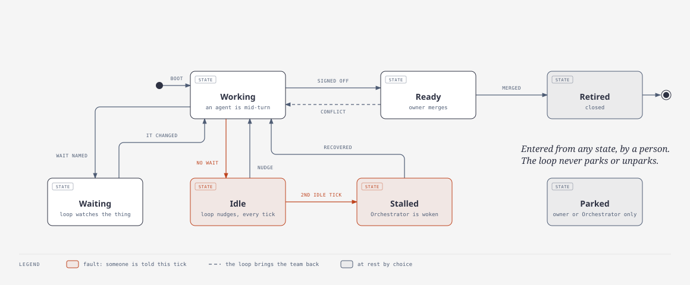
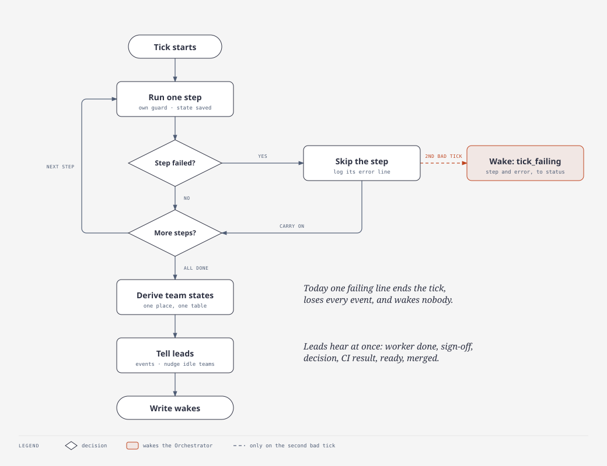

# Fleet cleanup: one design

Status: decided. Each **(Qn)** points to a row of the decision table at the end.
Scanned version: developer 4.3.6.

Diagrams of the design: team lifecycle ([svg](diagrams/lifecycle.svg), [html](diagrams/lifecycle.html)) and one
tick of the loop ([svg](diagrams/tick.svg), [html](diagrams/tick.html)). The command surface is a table below.

## Problem

The fleet grew one patch at a time. Each patch fixed a real case and added a command, a state, a wake or a config
key. The result works on a good day and fails in ways nobody is told about.

One day of running it showed the pattern:

- **The loop died for two hours and said nothing.** A disk check asked Docker for sizes while Docker was not running.
  The tick runs under `set -e`, so that one line ended every tick. Four pull requests merged in that window. No team
  was retired and no slot was refilled until the owner asked for status.
- **Four teams sat idle with work waiting.** A tester finished and its lead was never told. A decision was recorded
  and the lead never heard it. CI ended and nobody looked. The fleet showed each team as Idle, which reads as fine.
- **A team that was working showed as idle.** A worker that has reported done once keeps the Done state when its
  lead starts it again, so status shows the team at rest while an agent is mid-turn.
- **A command deletes without saying so.** `fleet branches` removes remote branches. Nothing in the name says delete.
- **37 commands, three typed by the owner.** In 30 days the owner typed `status`, `run` and `help`. The Orchestrator
  relied on about twelve. Eight were never run by anyone.

## Size today

| Part | Size |
|---|---|
| Scripts | 39 files, 9,045 lines. `common.sh` 1,628, `tick.sh` 1,288, `linear.sh` 959 |
| Tests | `test/run.sh` 4,720 lines, plus 18 files named after versions (`v413` … `v436`), 73 golden files |
| Skill text | `SKILL.md` 287 lines, references 1,578 lines (`output.md` alone 891) |
| Commands | 37 |
| Row states | 9 written, 2 more documented or read but never written |
| Wake types | about 25 |
| Config keys | about 45 |

## Principles

1. **One state per team, and every state says who moves next.** A reader of `fleet status` can tell, for each team,
   whether to wait, act or worry.
2. **Idle is a fault.** A team that is not parked and not ready has someone working or names what it waits for.
3. **Parked is a person's choice.** Only the owner or the Orchestrator parks and unparks. No schedule does either.
4. **The loop cannot die quietly.** A failing step is skipped and reported. A failing tick is a wake.
5. **Whoever must act is told.** An event goes to the agent that acts on it, when it happens.
6. **A command exists because someone types it.** Scripts that only the loop or an agent runs are not commands.
7. **A name says what it does.** A command that deletes has a verb that says so.
8. **Delete before adding.** A feature nobody used in 30 days goes, unless a decision keeps it.

## Team lifecycle

### Today

State lives on each agent row. The team's state is derived as the worst row. Nine states are written (Idle, Working,
Needs input, Stalled, Zombie, Failed, Done, Parked, Retired). `Booting` is documented and never written. `Dead` is read
and never written. `fixing` is a flag beside the state.

Faults in the model itself:

- Done is sticky. A worker restarted by its lead still reads Done.
- Parking a team overwrites Done rows, though the reference says it keeps them.
- The loop parks a team by itself when its PR is signed off, and unparks it by itself on a conflict or a new comment.
  So "Parked" means two things: set aside by a person, and finished and waiting for a merge.
- Idle has no owner. Nothing distinguishes "waiting for CI" from "forgot to carry on".

### Decided **(Q1, Q4, Q5, Q18)**

The team holds one state. Agent rows keep only liveness: running, at rest, or gone.

| State | Means | Who moves next |
|---|---|---|
| Working | An agent of the team is mid-turn | The team |
| Waiting | Nobody is running, and the lead named what it waits on: CI on a head, a merge of a PR, an answer from the owner, the usage limit | The loop watches that thing and wakes the lead when it changes |
| Idle | Nobody is running and no wait is named | The loop nudges the lead on this tick |
| Stalled | Still idle one tick after the nudge, or an agent is gone, or a brief did not arrive, or a prompt blocks an agent. Carries the reason | The Orchestrator, by wake |
| Ready | The PR head is signed off, CI is green, it can merge. The slot is free | The owner merges. The loop brings the team back to Working on a conflict, a red check or a new comment |
| Parked | Set aside by the owner or the Orchestrator. Panes closed, work kept | Only the owner or the Orchestrator |
| Retired | Closed. Worktrees removed | Nobody |

Transitions:

| From | Event | To |
|---|---|---|
| (none) | boot | Working |
| Working | every agent at rest, lead recorded a wait | Waiting |
| Working | every agent at rest, no wait recorded | Idle |
| Waiting | the awaited thing changed (CI ended, PR merged, answer given, limit lifted) | Working (lead told what changed) |
| Idle | tick nudges the lead with what changed since its last turn | Working, or stays Idle |
| Idle | still idle at the next tick | Stalled |
| Working, Waiting, Idle | an agent is gone, a brief failed, a prompt blocks | Stalled |
| Stalled | respawn, re-send or the Orchestrator's message succeeds | Working |
| Working, Waiting | head signed off, CI green, mergeable | Ready |
| Ready | conflict, red check, new comment, new head without sign-off | Working |
| Ready | PR merged | Retired (the loop retires at once) |
| any but Retired | `park` by a person or the Orchestrator | Parked |
| Parked | `park --undo` by a person or the Orchestrator | Working |
| any | `retire` | Retired |

What goes away: Done, Failed, Zombie and Needs input as team states (they become reasons on Stalled or Waiting), the
`fixing` flag (a Ready team that comes back is simply Working), `Booting`, `Dead`, and parking by the loop.

An agent's `done` stays as a report: outcome and summary. It is sent to the lead when it is written **(Q6)**.

## Tick

### Today

One script runs 23 steps in order under `set -euo pipefail`. Events and de-duplication keys are held in memory and
written once, at the end. When any unguarded step fails:

- the tick ends,
- every event of that tick is lost,
- side effects already done (messages, parks, respawns) repeat on the next tick,
- the wrapper counts a failure and, at most once in four hours, shows a desktop alert. It writes no wake.

Steps that can end the tick today include the Docker size check, a `du` over the worktrees, several registry reads and
the status-table checksum.

The lead is told about nine things (a stalled lead, a queued message, an API error, a failed brief, a new issue comment,
the overlap answer, a discovered PR, a new unsigned head, a conflict). It is never told that its tester finished or
signed off, that an escalation was resolved, that CI ended, that the PR is ready or merged, or that a sign-off failed.

Two rules decide "signed off". The loop accepts a sign-off from any tester row of the team. The merge queue also
requires the sign-off to name the PR.

### Decided **(Q1, Q6, Q7, Q17)**

- **Steps are isolated.** Each step runs in its own guard. A step that fails is skipped, logged with its error line,
  and the tick carries on.
- **State is saved per step.** A step's events and keys are written when the step ends. A later failure loses nothing
  already done and repeats nothing.
- **A tool that cannot answer is treated like a tool that is missing.** One warning, step skipped.
- **A failing loop is a wake.** The same step failing on two ticks in a row, or no good tick within two intervals,
  writes `tick_failing` with the step and the error line. `fleet status` shows it at the top.
- **The loop derives team state** from the table above, in one place, and writes it to the team.
- **Idle teams are nudged every tick.** The nudge says what changed since the lead's last turn: the tester's report and
  where it is, the decision and its text, the CI result on a head, or "nothing changed: say what you wait on".
- **Events go to the lead when they happen:** a worker's `done`, a sign-off, a resolved or decided escalation, CI
  ending on the PR head, the PR turning ready, a failed sign-off, a merge.
- **One sign-off rule.** The sign-off names the PR and its head. The loop and the queue call the same function.

Wake types shrink to what the Orchestrator acts on: `ready` (the merge queue changed), `merged`, `slot_free`,
`escalation`, `stalled` (with its reason), `tick_failing`, `usage_limit`, `claim` (lost or taken over), `report`
(morning). The rest become lines in status **(Q1)**.

## Command surface

37 commands today. Runs in the last 30 days on one machine: by the owner (typed), and by the Orchestrator (Bash).

| Command | Owner | Orchestrator | Decided | Notes |
|---|---|---|---|---|
| `status` | 114 | 1196 | **Keep** | |
| `run` | 27 | 39 | **Keep** | Absorbs `watch` and `schedule` |
| `help` | 6 | 83 | **Keep** | Lists only kept commands |
| `tell` | 2 | 459 | **Keep** | |
| `boot` | 0 | 419 | **Keep** | Claims the issue itself |
| `retire` | 0 | 313 | **Keep** | |
| `candidates` | 0 | 182 | **Keep** | Shows who holds a claimed issue |
| `decide` | 0 | 126 | **Keep** | No arguments lists open questions; `--answer` closes one |
| `park` | 0 | 24 | **Keep** | `park --undo` replaces `unpark` |
| `hold` | 0 | 5 | **Keep** | `hold --off` replaces `unhold` |
| `unpark` | 0 | 17 | Fold into `park` | |
| `unhold` | 0 | 4 | Fold into `hold` | |
| `claim` | 2 | 348 | **Keep (Q2)** | For claiming by hand. `boot` also claims by itself. `claim --who` replaces `holder`, `claim --take` replaces `takeover` |
| `holder` | 0 | 146 | Fold into `claim --who` and `candidates` | |
| `takeover` | 0 | 3 | Fold into `claim --take` and `boot --take` | |
| `escalations` | 0 | 61 | Fold into `decide` | |
| `resolve` | 0 | 118 | Fold into `decide --answer` | Sends the answer to the lead |
| `watch` | 0 | 16 | Fold into `run` | |
| `schedule` | 0 | 17 | Fold into `run` | |
| `escalate` | 0 | 0 | Internal | Agents call it |
| `next` | 0 | 8 | Internal | |
| `defer` | 0 | 14 | Internal | The loop runs it |
| `catchup` | 0 | 5 | Internal | The loop runs it |
| `respawn` | 0 | 3 | Internal | The loop runs it |
| `revive` | 0 | 0 | Internal | `tell` and the loop run it |
| `overlap` | 0 | 1 | Internal | The loop runs it |
| `redact-check` | 0 | 2 | Internal | Agents run it |
| `sandbox` | 0 | 2 | Internal | Agents and tests run it |
| `env` | 0 | 0 | Internal **(Q11)** | `boot` and `retire` run it |
| `events` | 0 | 0 | Internal | The scheduler runs it |
| `branches` | 0 | 1 | **Delete (Q3)** | `retire` and the loop do all branch deletion |
| `debrief` | 2 | 13 | Internal **(Q10)** | Lessons are written as a step of `retire` |
| `slim` | 0 | 7 | Delete **(Q9)** | |
| `focus` | 0 | 0 | Delete **(Q9)** | |
| `prime` | 0 | 0 | Delete **(Q9)** | `status` already says everything it says |
| `metrics` | 0 | 0 | Delete **(Q9)** | The morning report stays, as an internal script |
| `config` | 0 | 0 | Delete **(Q9)** | `run show` prints the profile and caps |

Result: 11 commands in `fleet help`, down from 37.

### Deleting branches **(Q3)**

`fleet branches` ran `git push origin --delete` over many branches behind a bare noun. The command is removed. `retire`
deletes its team's branches. The loop sweeps stale ones when the run profile allows it. There is no manual sweep.

## Features to remove **(Q9)**

| Feature | Why |
|---|---|
| Chat channel (`chat.sh`, `chat_*` keys) | No script calls it |
| `[context_window]` table | Never read |
| Slim panel style | Cosmetic, one offer per user, its own command |
| Focus | Never run. Parking the other teams by hand does the same |
| Metrics and the weekly summary | Never run by anyone. The morning report covers what is acted on |
| Prime | Duplicates status |
| `fleet config` | Never run. `run show` covers it |
| Overnight mode | Superseded by `fleet run` |
| After-merge parking | The loop no longer parks; a merged PR retires its team |

Kept: debrief and the expertise files, as a step of `retire` with no command **(Q10)**; team test environments, run by
`boot` and `retire` with no command **(Q11)**; the claim protocol between machines, unchanged **(Q8)**.

Config follows: every key of a removed feature goes. `events_label` and `merger` are used today and missing from the
example file; each is either listed or removed.

## Help text rules

- A usage line starts with `fleet <command>`, never with a script file name.
- The first line says what the command does to the user's world, in plain words. No list of internal steps.
- Help names no script, no skill route and no reference file.
- No history, no "legacy form", no notes to self such as `UNVERIFIED`.
- Help agrees with the skill text. Where they differ, one of them is wrong and is fixed.
- At most five lines before the options. Detail belongs in the reference, for the Orchestrator.

## User documentation

The guide a person reads is part of the release, with the same weight as the code. Today's README is 1,348 lines and
teaches 37 commands in three levels. It is rewritten for 5.0, and each pull request updates the part it changes.

What the guide holds, in this order:

1. **What the fleet is, in five lines,** and who it is for.
2. **Quick start:** install, `fleet run init`, `fleet run`, then what the first status table looks like. One screen.
3. **Reading status:** the seven team states as a table: what each means, who moves next, what to do. The lifecycle
   diagram sits here.
4. **Your day:** the three things an owner does (read status, merge what is ready, answer what is parked for you),
   each with a real example of the output.
5. **The eleven commands,** one short entry each: what it does in plain words, one example, what it prints.
6. **When something is wrong:** a table by symptom ("a team shows Stalled", "status says `tick_failing`", "nothing
   boots"), each with the cause and the one thing to do.
7. **Upgrading from 4.x:** every removed or renamed command with what to type now, and what happens to running teams.
8. **How it works,** last and short, for the curious: the loop, claims between machines, the merge gate. The tick
   diagram sits here.

Rules for the guide:

- Written for someone who has never opened a script. No script names, no state-file paths, no internal terms.
- Every command and every state in the guide exists in the release, and the reverse. A test compares the guide's
  command list and state list with `fleet help` and the state table, so the guide cannot drift.
- Every example is real output from the release, copied from a golden file.
- Under 400 lines. Detail for the Orchestrator stays in the skill's references.
- `fleet help <command>` and the guide say the same thing in the same words.

## Skill text

`SKILL.md` and its references carry every wake type, every state and every command. They shrink with them. The output
reference (891 lines) keeps one shape per kept command and per kept wake.

## Tests **(Q13)**

Today: one 4,720-line file and 18 files named after the version that added them. They are regrouped by area (lifecycle,
tick, claims, commands, guards), keep the golden files, and add the cases this design rests on:

- a step that fails does not end the tick, and its error becomes `tick_failing` on the second tick,
- a tool that is installed and cannot answer is skipped,
- a tester's `done` reaches an idle lead within one tick,
- an idle team with no named wait is nudged, then Stalled,
- a Parked team is never touched by the loop,
- a restarted worker is not shown as Done.

## Model and statechart **(Q14)**

The TLA+ model beside this file covers claims, the merge gate and authority. It does not model team state. The
lifecycle pull request will add the lifecycle above as a statechart file, and extends the model with Idle, Waiting and Stalled and one property:
a team that is not Parked, Ready or Retired is never at rest for two ticks without a named wait.

## Migration and release **(Q12, Q16)**

One major version, 5.0, with a list of breaking changes. Four pull requests land on a release branch and ship together.
Fleet teams build them, one team per pull request, in this order. Running teams stay on the installed version until
5.0 ships, so the fleet never runs half-built code.

1. **Tick core:** step isolation, state per step, `tick_failing`.
2. **Lifecycle:** team state, Waiting, the idle rule, Ready in place of loop parking, events to the lead, one sign-off rule.
3. **Surface:** commands folded, internal scripts out of help, help text rewritten, features removed, config pruned.
4. **Tests and docs:** regrouped tests, skill text and references cut to match, statechart and model, and the
   user guide rewritten end to end, with the upgrade section and the drift test.

Each of the first three pull requests also updates the guide for what it changes, so the guide is never behind main.

A registry written by the old version is read once and rewritten: Done, Failed, Zombie and Needs input rows map to
team states by the table above; a team the loop parked becomes Ready.

## Out of scope

- The claim protocol between machines (checked by the existing model) **(Q8)**.
- The team templates and what each role does.
- The house rules.
- herdr itself.

## Carried over from earlier notes **(Q15)**

Faults noted before this design that it does not settle by itself. Each belongs to the pull request named.

| Fault | Belongs to |
|---|---|
| The catch-up counter for a conflicting PR never resets, so a PR that caught up cleanly three times is refused | Lifecycle |
| A team that opens several PRs is tracked by the first one only: it reads as merged while others are open | Lifecycle |
| A stacked PR shows as ready while its base is another PR's branch | Lifecycle |
| `decide` treats any question containing the word "merge" as the owner's, though only merging a PR is | Surface |
| After `/clear` the Orchestrator row points at the old session and nobody follows the wakes | Tick core |
| Agents left on a login or first-run screen read as API errors; one clear Stalled reason and one restart for all | Lifecycle |
| `retire` on a name with no live rows leaves its branches and worktrees, and `boot` then refuses the name | Surface |
| The overlap check tells a team to wait for its own PR | Tick core |
| The overlap check tells two teams with no PR yet to wait for each other, so neither ever builds. A wait on a team that is itself Waiting is refused; the lower issue number goes first | Lifecycle |
| Leads cannot post the PR comment on the issue: the tool is not in their session | Surface |
| Testers commit or push to the PR branch; the guard should refuse it for that role | Surface |
| The bash guard blocks a file that only names the tracker key variable | Surface |

Settled by this design: a lead that ran done while waiting on another PR (Waiting), a lead never told that the PR it
waited on merged (events to the lead), the loop ending when a tool cannot answer (step isolation), the output shape
(already written down). Left for later, outside 5.0: clickable PR links, a per-repo pause for boots.

## Decisions

| # | Question | Decided |
|---|---|---|
| Q1 | How deep does this go? | Rebuild the tick's core and the state model; keep claims, boot, retire and the templates |
| Q2 | Which commands stay in `fleet help`? | Eleven: status, run, boot, tell, retire, park, candidates, decide, hold, claim, help |
| Q3 | `fleet branches` | Deleted; `retire` and the loop do all branch deletion |
| Q4 | The idle rule | Nudge every tick; Stalled one tick later |
| Q5 | A named wait as its own state | Yes: Waiting, with the thing awaited, watched by the loop |
| Q6 | Which events go straight to the lead | All seven: worker done, sign-off, decision or answer, CI result, ready, merged, failed sign-off |
| Q7 | A failing tick step | Skip, log, carry on; `tick_failing` after two bad ticks |
| Q8 | Claims between machines | Protocol unchanged; `holder` and `takeover` fold into `claim`, `boot` and `candidates` |
| Q9 | Unused features | Removed: chat, slim, `[context_window]`, focus, prime, metrics and the weekly summary, `fleet config`, overnight mode |
| Q10 | Debrief and expertise files | Kept as a step of `retire`; the command goes |
| Q11 | Team test environments | Kept, internal |
| Q12 | Release shape | One 5.0, four pull requests on a release branch |
| Q13 | Tests | Regrouped by area; golden files stay |
| Q14 | Statechart and model | Lifecycle statechart file, and the model extended with the idle property |
| Q15 | Earlier notes | Carried over where still true (table above) |
| Q16 | Who builds it | Fleet teams, one per pull request, after this spec merges |
| Q17 | One sign-off rule | The sign-off names the PR and its head |
| Q18 | A signed-off team waiting for its merge | Ready, a state of its own; the loop never parks |
